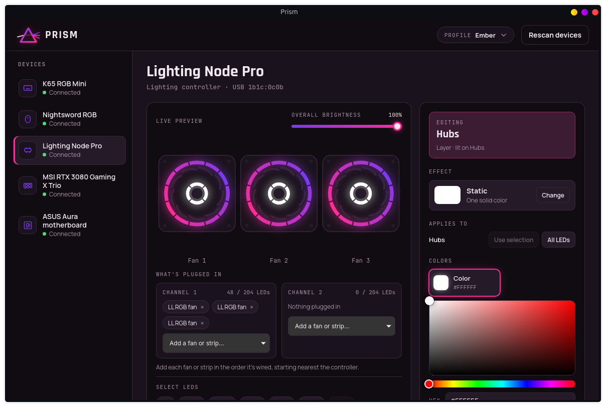
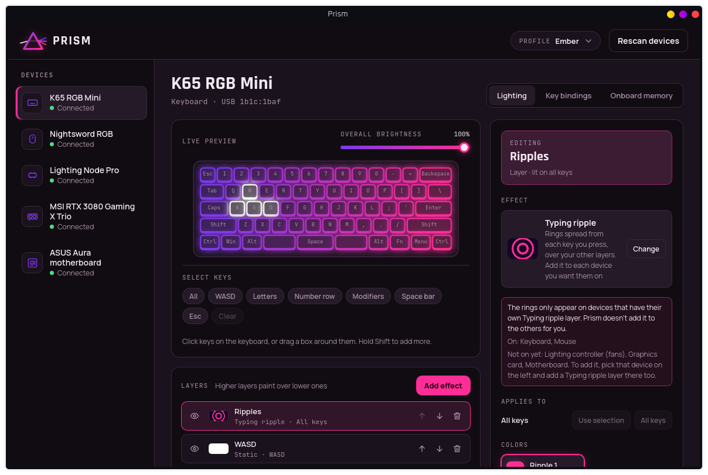
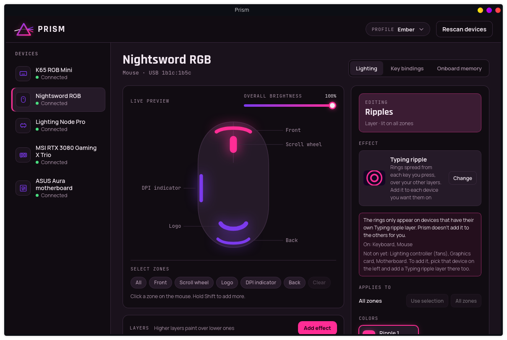
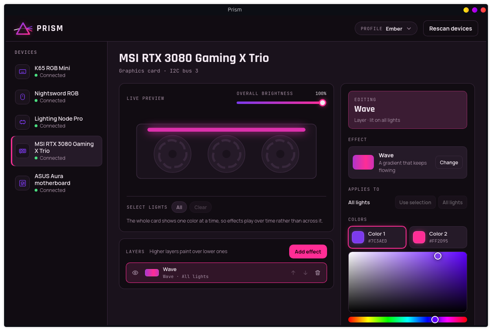
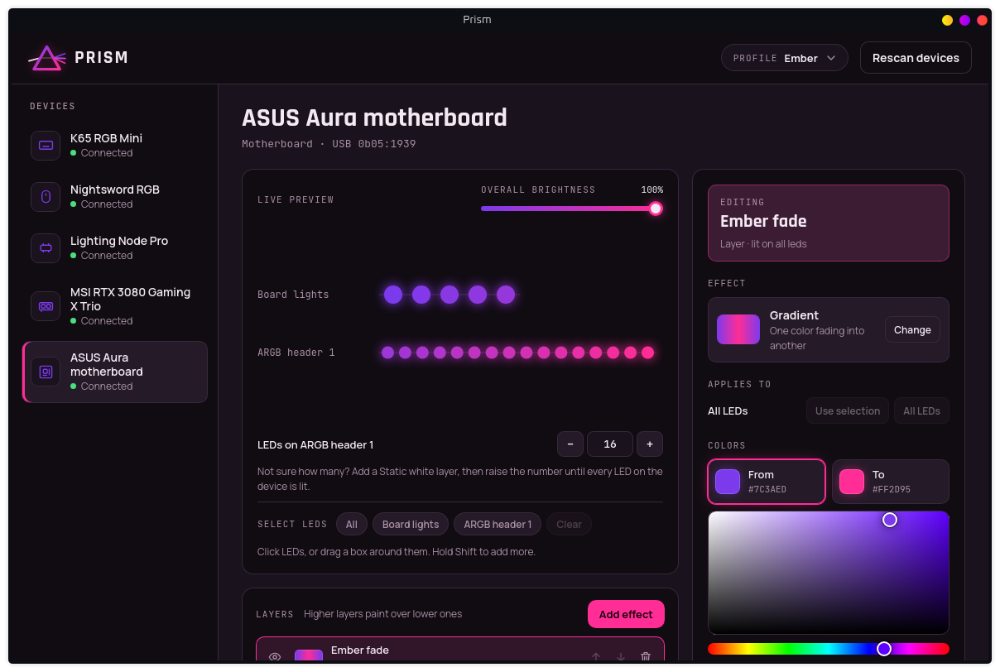
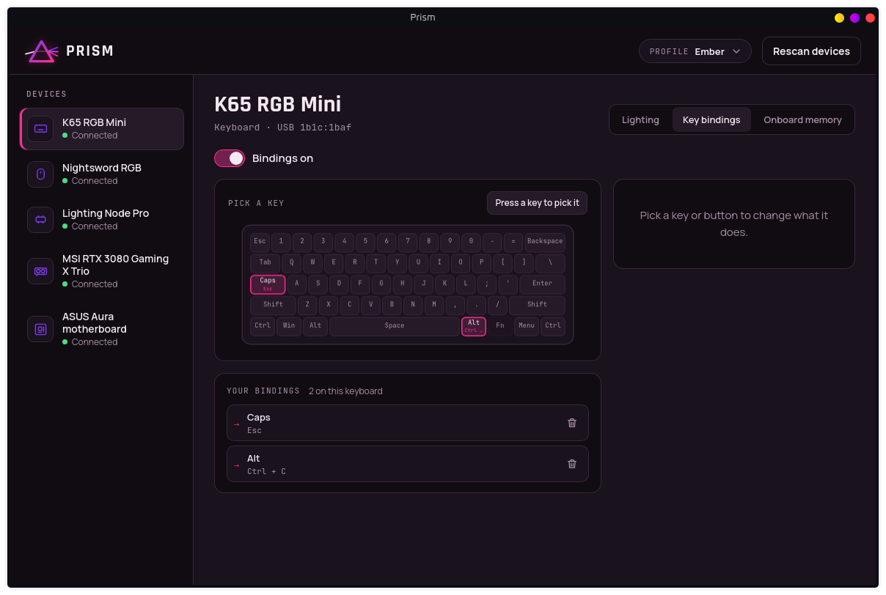
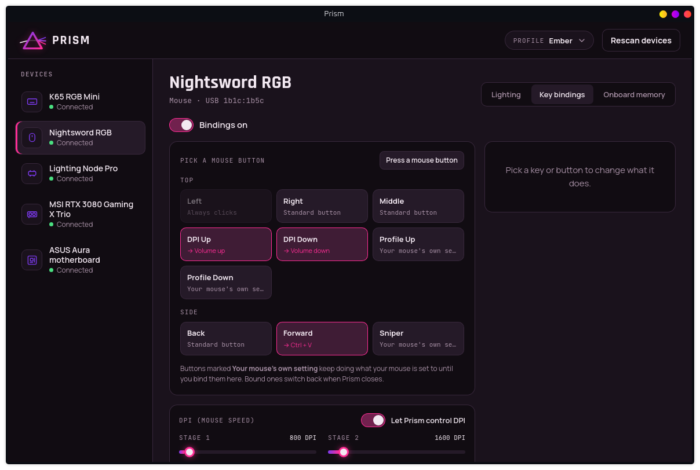
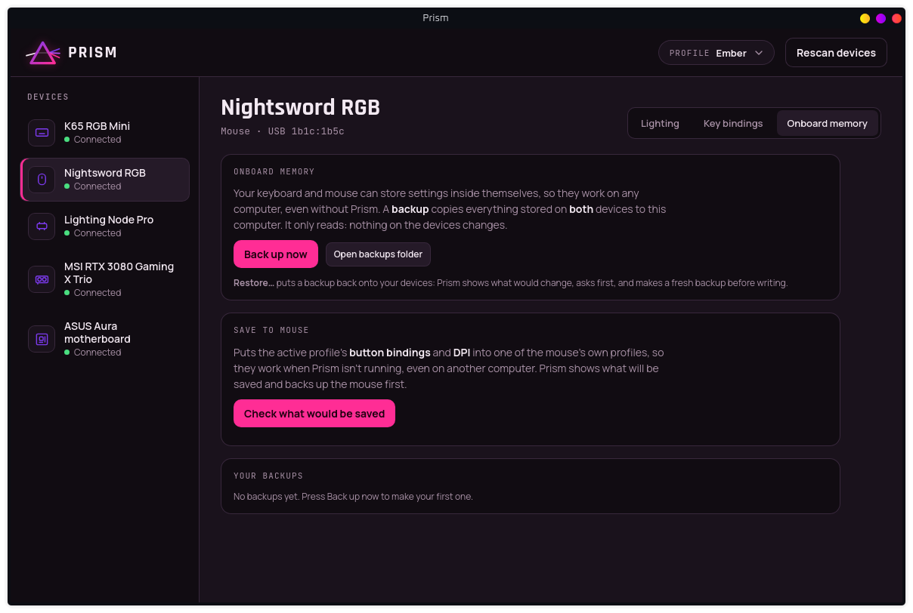

# Prism

**Corsair lighting, key bindings and onboard memory on Linux, plus your
graphics card and motherboard lighting, in one small app that stays out of
your way.**



Prism is an iCUE-style control center written for Linux from scratch. It
runs effects across every device you own, remaps keys and mouse buttons,
saves your setup into the devices' own memory, and then shrinks to a
~28 MB tray process when you close the window.

> Prism is an independent project. It is not made, endorsed or supported by
> Corsair, MSI or ASUS. Corsair and iCUE are trademarks of Corsair Gaming, Inc.

> **Built with AI.** Prism's code was written by an AI coding assistant
> (Claude, by Anthropic), directed and tested on real hardware by its human
> maintainer, HoneyBadger. Commits made this way are marked
> `Co-Authored-By: Claude`. Everything marked *Tested* below was checked on
> real devices, and the code has automated tests. But no human has reviewed
> every line the way they would code they wrote themselves. Prism talks to
> your hardware directly and can write to your devices' memory, so read the
> code, or decide it's not for you, before you rely on it.

---

## What it does

### Lighting on every device, from one place

- **10 effects:** static, gradient, wave, breathe, rainbow, color cycle,
  comet and strobe, plus two that react to typing: Typing ripple and Key
  glow.
- **Layers:** stack effects and paint them onto any LEDs you pick. Click
  keys, zones or fan LEDs, or drag a box around them.
- **Profiles:** switch from the app or from the tray menu.
- **Typing ripple:** every key press sends a ring of color out from that
  key. The ring spreads across the keyboard, reaches the mouse a moment
  later, then the fans, motherboard and graphics card behind it. Use one
  color, a list that takes turns, or random colors. The ring paints over
  your other layers, so the base look stays.
- **Key glow:** each key you press lights up for a moment, then fades,
  and only that key. It fades back to your other layers, or to black if
  there are none. Colors work like the ripple's (one, a list, or random),
  and the speed sets how quickly it fades. A mouse click glows the
  mouse's front.
- **Typing effects only read where a key is.** Prism listens for presses
  only while a Typing ripple or Key glow layer is on, and nothing about
  what you type is recorded or stored.
- **What's plugged in:** tell Prism which fans and strips are on each
  lighting-controller channel. It knows 18 kinds: LL, QL, HD, ML and SP
  fans, LED strips, LS100, LC100, and Hydro X pumps and blocks.

| Keyboard | Mouse |
|---|---|
|  |  |
| **Graphics card** | **Motherboard** |
|  |  |

### Key and button bindings

Any key or mouse button (except Left click) can become:
- another key, including media keys
- a key combo such as Ctrl+C
- a recorded macro: play once, repeat while held, or toggle
- an app to open
- DPI up, down, cycle or sniper

| Keyboard | Mouse, with DPI stages |
|---|---|
|  |  |

### Onboard memory: your setup without Prism

Prism can write a profile **into the keyboard's and mouse's own memory**,
so it works with Prism closed, or on another computer. It saves:
- single keys, media keys, combos and macros
- mouse buttons acting as other mouse buttons
- DPI stages and sniper DPI
- lighting: Rainbow, Color cycle and Breathe become the device's own
  moving effects; anything else is saved as a still picture.

Every save starts with a **full backup**, and every file is read back to
check it. **Restore** shows exactly what would change before it writes
anything. Backups can be deleted later, after an "are you sure?".



### Stays light in the background

Closing the window doesn't quit Prism. It restarts itself as a tray-only
process, without the web engine that draws the window, so your lighting and
bindings keep running on very little memory (numbers below). Lighting
carries on through the restart without a flicker. Prism can start with your
login, and only one copy ever runs.

---

## Performance (measured, not guessed)

All numbers were measured on 2026-10-16 on:
- an AMD Ryzen 9 5900X with 32 GB of RAM
- Arch Linux (kernel 7.2), KDE Plasma on Wayland
- a K65 RGB Mini, Nightsword RGB, Lighting Node Pro with 3 LL fans, an MSI
  RTX 3080 Gaming X Trio and an ASUS Aura motherboard, all driven at once

| Situation | Memory (PSS) | CPU (share of one core) |
|---|---|---|
| **In the tray, still lighting on every device** | **27.6 MB** | **0.0%** |
| In the tray, waves on fans, GPU and board, ripples on keyboard and mouse | 27.7 MB | 3.8% |
| In the tray, Rainbow on all 5 devices | 27.6 MB | 5.0% |
| Window open, live preview running | 237 MB | ~21% |
| *For comparison:* OpenRGB 0.9, started minimised, its saved profile | 42.2 MB | 15.6% |

How these were measured:
- **Memory:** PSS (each shared library page split fairly between the
  programs using it), from `/proc/<pid>/smaps_rollup`, added up over the
  process and any child processes. Plain RSS, which counts shared
  libraries in full, is about 53 MB in the tray.
- **CPU:** user plus system time over 60 seconds (30 with the window open),
  read from `/proc/<pid>/stat`.
- **OpenRGB** supports far more hardware than Prism. Its numbers are only
  here for context, not as a fair benchmark of the two projects.

Why it's this small:
- **Animated effects run at about 30 frames a second, still ones don't run
  at all.** With nothing moving, Prism only sends each device a
  "still here" message every few seconds.
- **The graphics card is updated at most 10 times a second, sending only
  the colors that changed.** Its lighting chip is on a slow I2C bus where
  each message costs about 1 ms of CPU. That's most of the remaining CPU
  use above; the other four devices together use about 1–1.5%.
- **No web engine in the tray.** The window's web engine accounts for
  ~210 MB, and it's gone as soon as the window closes.

---

## Supported devices

**Tested** means checked on real hardware. **Experimental** means Prism
follows the protocol notes of OpenRGB, ckb-next or OpenLinkHub for that
model, but nobody has tried it with Prism yet. Experimental devices show as
"Experimental" in the app; reports are very welcome.

| Device | Lighting | Bindings | Onboard memory | Status |
|---|---|---|---|---|
| **K65 RGB Mini** keyboard | ✓ per key | ✓ | ✓ keys, combos, macros, media, lighting | Tested |
| **Nightsword RGB** mouse | ✓ 5 zones | ✓ 9 buttons (not Left), DPI | ✓ buttons, DPI, macros, lighting | Tested |
| **Lighting Node Pro** | ✓ per LED, 2 channels | | | Tested |
| Lighting Node Core, Commander Pro, LS100, LT100, Obsidian 1000D, SPEC-OMEGA RGB | ✓ per LED | | | Experimental |
| M65 RGB / PRO / RGB Elite, Sabre RGB / Optical, Scimitar RGB / PRO / Elite, Ironclaw RGB, Harpoon RGB / PRO, Glaive RGB / PRO | ✓ per zone | | | Experimental |
| **MSI RTX 3080 Gaming X Trio** (`10de:2206`, `1462:3892`) | ✓ one color | | | Tested |
| **ASUS Aura motherboard** (USB `0b05:1939`) | ✓ board lights and ARGB headers | | | Tested |

Graphics cards are only ever driven if their exact PCI IDs are on Prism's
safe list, using only the address and lighting registers known for that card.

---

## Install

### The installer (recommended, any distribution)

```sh
git clone https://github.com/HoneyBadger614/prism-rgb.git
cd prism-rgb
./install.sh
```

The installer explains each step and asks before doing it:

1. **System packages** Prism needs to build, using your distribution's
   package manager (asks for your password).
2. **Rust**, if yours is missing or too old, from the official rustup.rs,
   for your user only.
3. **Build** Prism (a few minutes the first time).
4. **Install for your user:** to `~/.local/bin`, with an app menu entry and
   icon.
5. **Device permissions:** a udev rule, so Prism never needs root (asks for
   your password; details below).

To **update**, run `git pull` and then `./install.sh` again.
To **remove** Prism, run `./install.sh --uninstall` (keeps your settings
and backups) or `./install.sh --purge` (removes everything).

| Distribution | Installer |
|---|---|
| Arch, Manjaro, EndeavourOS, CachyOS, Garuda | ✓ tested on Arch |
| Ubuntu 22.04+, Debian 12+, Linux Mint, Pop!_OS, Zorin, elementary, KDE neon | package list from Tauri's guide, not yet tested |
| Fedora, Nobara | package list from Tauri's guide, not yet tested |
| openSUSE | package list from Tauri's guide, not yet tested |
| Anything else | install the equivalent packages yourself, then `./install.sh --no-deps` |

If it fails on your distribution, please open an issue with the error, or
better, the fix.

### Ready-made packages

Each release on the [Releases page](https://github.com/HoneyBadger614/prism-rgb/releases)
has packages built on Ubuntu 22.04:

- **`.deb`** for Ubuntu, Debian, Mint and Pop!_OS:
  `sudo apt install ./Prism_*_amd64.deb`
- **`.rpm`** for Fedora and openSUSE:
  `sudo dnf install ./Prism-*.x86_64.rpm`
- **AppImage** for anything else: make it executable and run it. You also
  need the udev rule installed by hand (below).

The `.deb` and `.rpm` install the device permission rule for you; unplug
and replug your devices afterwards. (Until the first release is published,
use the installer.)

### By hand

If you'd rather see every step, here are the build packages for each
distribution.

```sh
# Arch
sudo pacman -S --needed base-devel rust webkit2gtk-4.1 libappindicator librsvg
# Ubuntu / Debian / Mint / Pop!_OS (then install Rust from https://rustup.rs)
sudo apt install build-essential pkg-config libssl-dev libgtk-3-dev libwebkit2gtk-4.1-dev \
  libayatana-appindicator3-dev librsvg2-dev libudev-dev libxdo-dev
# Fedora (then install Rust from https://rustup.rs)
sudo dnf install gcc gcc-c++ make pkgconf-pkg-config openssl-devel webkit2gtk4.1-devel \
  libappindicator-gtk3-devel librsvg2-devel systemd-devel libxdo-devel
```

Then build Prism and add it to your app menu:

```sh
cargo build --release -p prism-rgb
scripts/install-desktop.sh   # menu entry pointing at target/release (handy while developing)
```

### Device permissions

Prism never runs as root. A udev rule lets the person logged in at the
computer use the devices Prism controls. The installer and the packages set
it up; to do it by hand:

```sh
sudo install -Dm644 packaging/60-prism.rules /etc/udev/rules.d/60-prism.rules
sudo udevadm control --reload && sudo udevadm trigger
```

Then unplug and replug your devices, or restart. The rule covers:
- Corsair USB devices and the ASUS Aura controller
- Corsair key and button events, for bindings and typing ripples
- the virtual keyboard bindings type through
- only the one NVIDIA I2C bus the graphics card's lighting chip is on

Note that allowing key events means programs you run can read your Corsair
keyboard's presses. Bindings need that.

If another RGB app (OpenRGB, ckb-next, iCUE in a VM...) runs at the same
time, the two will fight over the devices, so use one at a time.

---

## How it works

```
 ui/            the screens: plain HTML, CSS and JavaScript, no web framework
  │  (Tauri commands only: no file, shell or network access from the window)
 src-tauri/     the app: lighting engine thread, tray, bindings, backups
  │
 crates/prism-core/   device drivers and the effects maths
   ├─ k65_mini.rs       Corsair "Bragi" protocol (K65 RGB Mini)
   ├─ nightsword.rs     Corsair's older protocol (Nightsword and similar mice)
   ├─ lighting_node.rs  Lighting Node Pro family
   ├─ msi_gpu.rs        MSI graphics cards over I2C
   ├─ asus_aura.rs      ASUS Aura USB motherboard lighting
   ├─ effects.rs        layers, effects, ripples, the "desk" devices sit on
   ├─ kb_onboard.rs / mouse_onboard.rs   the devices' own file formats
 crates/prism-input/  key remapping (evdev grab + uinput), macros, recording
```

- **One engine thread** works out every LED's color, sends each device what
  changed, and keeps devices that need it awake with "still here" messages.
  It finds devices again by itself if they're unplugged and replugged.
- **Bindings** take over only the Corsair input devices that have a bound
  key, and send the results through a virtual device, so everything else
  types normally. Left click can never be rebound, and the K65's Fn key is
  never saved to its memory, so you can't lock yourself out.
- **Onboard formats** were worked out by comparing the devices' memory
  before and after an iCUE save in a virtual machine. Prism's files for the
  same settings match iCUE's byte for byte (checked in the tests). Each
  format is written up in comments at the top of `kb_onboard.rs` and
  `mouse_onboard.rs`. No raw USB recordings are kept, since they can
  contain keystrokes.

## Privacy and safety

- **Nothing leaves your computer.** Prism has no network code, and no
  fonts, scripts or anything else load from the internet.
- **Key presses** are only read for bindings, and for typing ripples while
  a ripple layer is switched on. For ripples, only the key's position is
  used; nothing is recorded or stored.
- **Before any onboard write,** Prism takes a full backup and shows what
  will change.

## License

GPL-3.0-or-later. See [LICENSE](LICENSE).

Prism's code is written from scratch. OpenRGB, ckb-next and OpenLinkHub
were used only as references for device facts (USB IDs, zone numbers, LED
counts); no code is copied from them.
